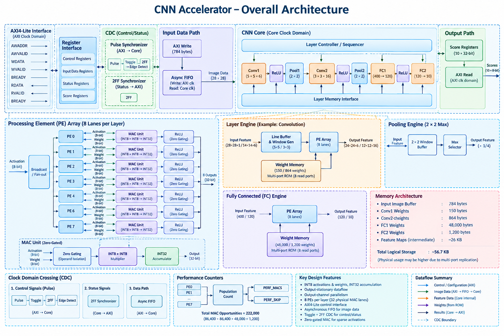
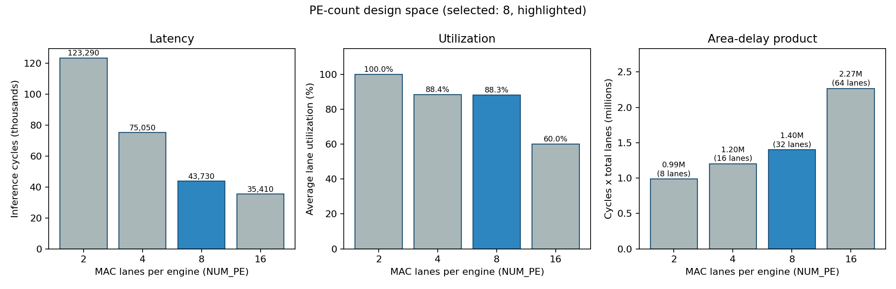
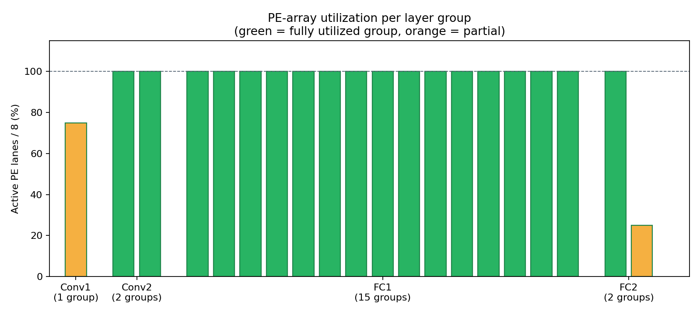
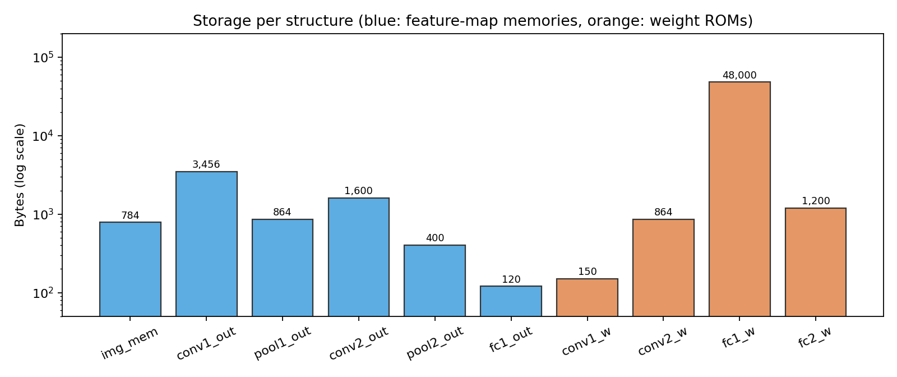
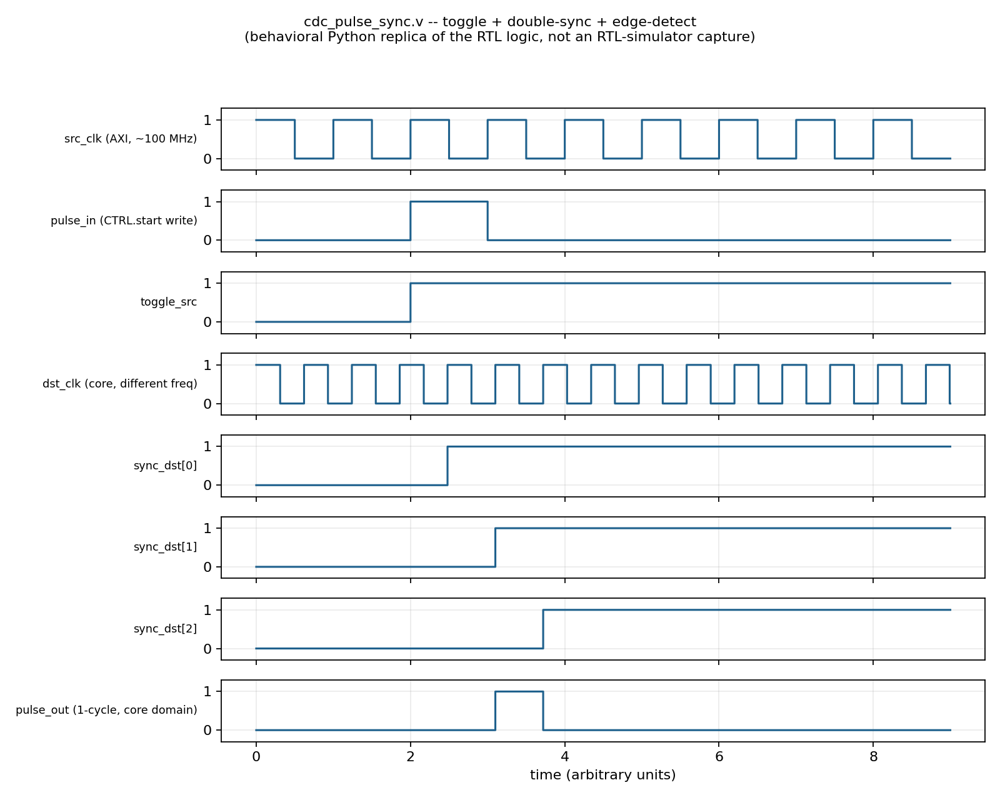
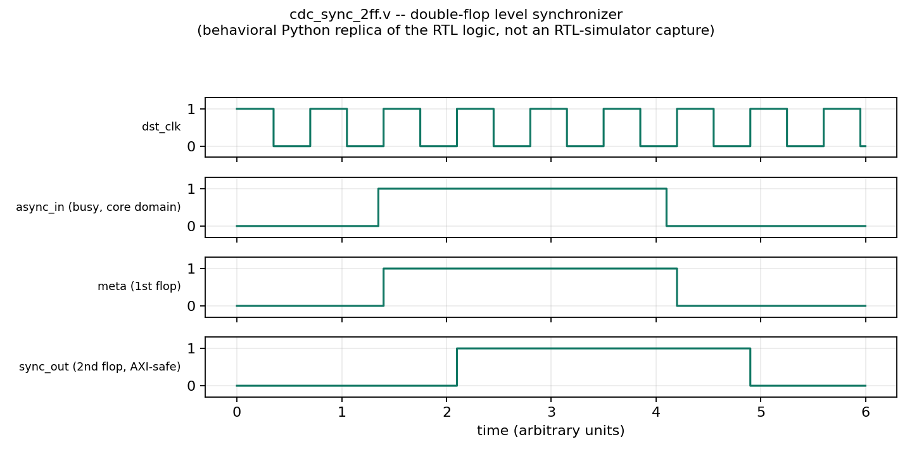
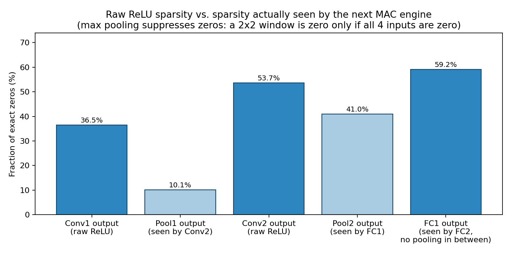
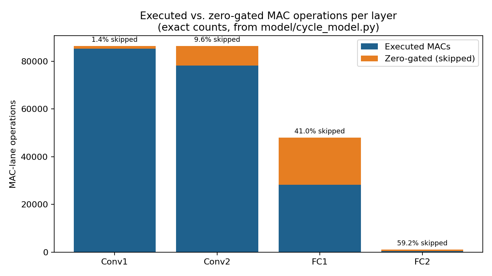
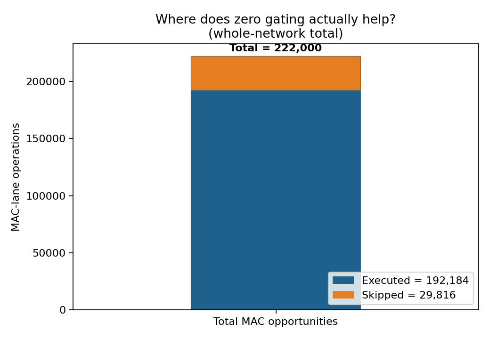
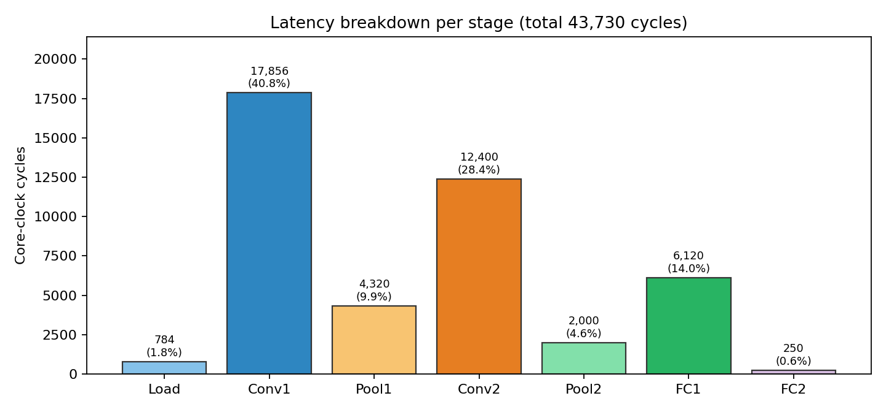

# Quantized, Sparsity-Aware CNN Accelerator with AXI4-Lite Integration and Clock Domain Crossing

I designed a complete CNN inference subsystem in synthesizable Verilog: a quantized LeNet-style network, an output-stationary MAC-lane datapath, an AXI4-Lite control and data interface, three purpose-chosen clock domain crossing mechanisms, ReLU-driven zero gating with hardware performance counters, and a bit-exact Python reference model that the testbench checks against.

This document walks through every decision I made, why I made it, the mathematics behind it, and the numbers and plots that back it up. Everything in it is reproducible from the scripts in this repository.

---

## Table of contents

1. [Overview](#1-overview)
2. [Results at a glance](#2-results-at-a-glance)
3. [Repository layout](#3-repository-layout)
4. [Build, simulate, reproduce](#4-build-simulate-reproduce)
5. [Network architecture and the reasoning behind it](#5-network-architecture-and-the-reasoning-behind-it)
6. [Fixed-point arithmetic](#6-fixed-point-arithmetic)
7. [System architecture](#7-system-architecture)
8. [Compute architecture](#8-compute-architecture)
9. [AXI4-Lite interface](#9-axi4-lite-interface)
10. [Clock domain crossing](#10-clock-domain-crossing)
11. [Zero gating and sparsity](#11-zero-gating-and-sparsity)
12. [Other design decisions](#12-other-design-decisions)
13. [Verification](#13-verification)
14. [Results and analysis](#14-results-and-analysis)
15. [Scope and extensions](#15-scope-and-extensions)
16. [Appendix: sizing mathematics](#16-appendix-sizing-mathematics)

---

## 1. Overview

The problem asks for an accelerator subsystem, not an isolated convolution block. I therefore treated the work as four coupled design problems and solved each one explicitly:

| Problem | What I built | Where |
|---|---|---|
| CNN compute | Two convolution layers, two max-pool layers, two fully connected layers on an INT8 datapath with INT32 accumulation, executed by 8-lane output-stationary MAC arrays | `rtl/conv_layer_engine.v`, `rtl/fc_layer_engine.v`, `rtl/pool_engine.v`, `rtl/pe_array.v`, `rtl/mac_unit.v` |
| Processor interface | AXI4-Lite slave with a register map for start, status, input pixels, performance counters and the ten output scores | `rtl/axi4_lite_slave.v` |
| Clock domain crossing | Toggle-based pulse synchronizer for `start`, double-flop synchronizers for status levels, gray-coded asynchronous FIFO for the input pixel stream | `rtl/cdc_pulse_sync.v`, `rtl/cdc_sync_2ff.v`, `rtl/async_fifo.v` |
| Power and logic optimization | Activation zero gating with operand isolation at every MAC lane, plus counters that record how many multiplies were suppressed | `rtl/mac_unit.v`, `rtl/perf_counters.v` |

The dataflow through the subsystem follows the required structure:

```
AXI4-Lite master --> AXI slave --> CDC --> sequencer + layer engines --> scores --> AXI read-back
```

Three ideas shape the whole design. First, I kept one MAC-lane design and reused it for convolution and fully connected layers, so there is a single datapath to get right. Second, I made the compute schedule deterministic and data independent, which makes the cycle count exactly predictable and lets the testbench check hardware counters against closed-form values. Third, I matched each CDC technique to the kind of signal it carries instead of using one generic synchronizer everywhere.

---

## 2. Results at a glance

| Metric | Value |
|---|---|
| Network | 28x28x1 input, Conv 5x5x6, MaxPool, Conv 3x3x16, MaxPool, FC 400 to 120, FC 120 to 10 |
| Precision | INT8 activations, INT8 weights, INT32 accumulators |
| Parallelism | 8 MAC lanes per layer engine, output-channel parallel |
| Total cycles per inference | 43,730 |
| Core clock used in the testbench | 150 MHz |
| Inference latency | $43{,}730 / 150\,\mathrm{MHz} \approx 291.5\,\mu s$ |
| Throughput | about 3,430 inferences per second |
| MAC-lane events per inference | 222,000 (fixed by the network shape) |
| Executed MACs | 192,184 |
| Zero-gated MACs | 29,816 (13.4 percent of all MAC events) |
| Peak zero-gating benefit | FC2 at 59.2 percent, FC1 at 41.0 percent |
| Clock domains | `axi_aclk` at 100 MHz and `core_clk` at about 150 MHz, independent |
| Logical storage | 58,086 bytes (weights 50,214 B, feature maps 7,224 B, biases 608 B, score registers 40 B) |
| Verification checks | 3 self-checking tests: golden-model match, repeated inference, counter invariant |

Figures for every row are in [Section 14](#14-results-and-analysis).

---

## 3. Repository layout

```
rtl/     Synthesizable Verilog, one module per file
tb/      Self-checking testbench and generated test-vector hex files
model/   Python tooling: reference model, schedule model, sweeps, figure generation
sim/     One-command pipeline scripts for Linux, macOS, WSL and Windows
docs/    images/ holds every figure embedded in this document
```

`model/` in more detail, in the order a fresh run touches the files:

```
weights_source.py         single source of truth for weights and the test image
config.py                 dimensions, precision, shift constants (mirrors rtl/cnn_pkg.vh)
golden_model.py           bit-exact NumPy forward pass
generate_vectors.py       writes model/hex/*.hex and tb/*.hex
cycle_model.py            deterministic schedule model: cycles, MACs, skipped MACs
pe_sweep.py               PE-count design-space sweep (2, 4, 8, 16 lanes)
generate_figures.py       writes docs/images/*.png
update_readme_results.py  writes the testbench report into Section 13.3 of this file
```

---

## 4. Build, simulate, reproduce

### 4.1 Requirements

Icarus Verilog (`iverilog` and `vvp`), Python 3, and the packages `numpy` and `matplotlib`.

```
pip install numpy matplotlib
```

On Windows, install Icarus Verilog from <https://bleyer.org/icarus/> with the "Add to PATH" option enabled, then confirm with `iverilog -V`. On Linux, macOS and WSL use the package manager of your distribution.

### 4.2 One command

From the repository root:

```
bash sim/run_sim.sh          # Linux, macOS, WSL
sim\run_sim.bat              # Windows
```

The script runs five steps in order:

1. Regenerate the weight, bias, image and expected-score hex files.
2. Compile all RTL and the testbench with Icarus Verilog.
3. Simulate. The testbench prints the per-test report and writes `sim/rtl_results.txt`.
4. Patch Section 13.3 of this README with the measured counters and the comparison against the schedule model.
5. Regenerate every figure under `docs/images/`.

### 4.3 Running individual steps

```
cd model
python generate_vectors.py     # test vectors
python cycle_model.py          # schedule model
python pe_sweep.py             # PE-count sweep
python generate_figures.py     # figures
```

### 4.4 Troubleshooting a quiet run

Step 3 can be silent for a while because Icarus Verilog is an interpreter and the FC1 weight ROM has 48,000 entries with 8 read ports. The testbench prints progress roughly every 196 image bytes and every 200 status polls. If `vvp` is using CPU, the run is progressing.

The testbench also protects itself against protocol stalls. Each AXI read and write gives up after 200 stalled cycles and names the handshake signal that never arrived (AWREADY, WREADY, BVALID, ARREADY or RVALID). The wait-for-done loop stops after 5,000 polls and prints the last STATUS value. A global timeout of 4,000,000 ns backstops everything else. Any of these messages identifies the module to inspect first.

### 4.5 Swapping in a trained model

The verification workload uses a fixed-seed INT8 parameter set so results are deterministic. To evaluate a trained network, edit only `get_weights_and_image()` in `model/weights_source.py`. Every script imports that one function, so vectors, schedule model, figures and README patching all pick up the change together.

1. Train and quantize a network with the topology in [Section 5](#5-network-architecture-and-the-reasoning-behind-it), using symmetric per-tensor INT8 quantization to $[-128, 127]$.
2. Return the eight parameter arrays and a 28x28 test image from `get_weights_and_image()`, with the same shapes as the current version.
3. If your per-layer scales differ, update `SHIFT_CONV1`, `SHIFT_CONV2` and `SHIFT_FC1` in both `model/config.py` and `rtl/cnn_pkg.vh`.
4. Run the pipeline. No RTL change is needed because only the values in the hex files change.

---

## 5. Network architecture and the reasoning behind it

```
Input 28x28x1
  -> Conv1 (5x5, 6 filters, stride 1, valid)    -> 24x24x6
  -> ReLU
  -> MaxPool 2x2, stride 2                      -> 12x12x6
  -> Conv2 (3x3, 16 filters, stride 1, valid)   -> 10x10x16
  -> ReLU
  -> MaxPool 2x2, stride 2                      -> 5x5x16
  -> Flatten (400, channel-major)
  -> FC1 (400 -> 120), ReLU
  -> FC2 (120 -> 10), raw scores
```

I describe this as a LeNet-inspired compact CNN. It follows the LeNet pattern of alternating convolution and pooling followed by fully connected layers, but the kernel sizes, pooling and layer widths are my own choices, so I do not label it canonical LeNet-5.

The problem statement leaves layer structure, parallelism, storage and precision to the designer. I chose the network to give the hardware something real to reason about while remaining fully implementable and verifiable end to end.

### 5.1 Two convolution layers

One convolution layer makes the accelerator almost trivial: there is no multi-channel reuse and no intermediate feature-map traffic to analyze. Three or more layers add memory, control states and verification effort without adding a new architectural idea. Two layers is the smallest depth that produces multi-channel weight reuse, real feature-map storage, and a genuine lane-sizing problem.

### 5.2 A 5x5 kernel first and a 3x3 kernel second

The number of multiply-accumulate taps per output element is

$$N_{\mathrm{taps}} = C_{\mathrm{in}} \times K \times K .$$

Conv1 has one input channel, so a 5x5 kernel costs only $N_{\mathrm{taps}} = 1 \times 5 \times 5 = 25$ and gives a larger receptive field where it is cheapest. Conv2 has six input channels, so a 3x3 kernel gives $N_{\mathrm{taps}} = 6 \times 3 \times 3 = 54$. A 5x5 kernel there would need $6 \times 5 \times 5 = 150$ taps, about 2.8 times more work for a receptive-field gain that a network this shallow does not need.

### 5.3 Valid padding and stride 1

With valid convolution the output size is

$$OH = IH - K + 1, \qquad OW = IW - K + 1 .$$

Nothing has to generate artificial zeros, so the address generator has no boundary cases. Stride 1 keeps every output position backed by a full receptive field, and pooling handles the downsampling.

### 5.4 Max pooling instead of average pooling

Max pooling needs only a compare tree (`rtl/max_pool2x2.v`). Average pooling needs an adder tree plus a divide or scale step and introduces rounding behavior. Max pooling is exact in integer arithmetic and smaller in hardware.

### 5.5 ReLU

$$\mathrm{ReLU}(x) = \max(0, x)$$

is one comparator and one mux. Sigmoid and tanh need exponentials or lookup tables. ReLU is also the source of the sparsity that the zero-gating optimization exploits, so the activation function and the power optimization form one coherent story.

### 5.6 Layer widths of 6, 16, 120 and 10

Six and sixteen filters are the classic LeNet widths. They give enough compute to demonstrate parallelism while keeping storage small. Four and eight filters would make the accelerator a toy, and sixteen and thirty-two would multiply memory and simulation time. The FC1 width of 120 and the 10-way output follow the same pattern, and using two fully connected layers lets the same MAC-lane design serve both convolution and dense layers.

### 5.7 Biases

Each neuron computes

$$y = \sum_i x_i w_i + b .$$

The bias costs one addition per output element, which is negligible next to hundreds of MACs, so I included it to match how real networks are computed.

### 5.8 Tensor shapes and workload

| Stage | Output shape | Elements | Dense MACs |
|---|---|---|---|
| Input | 28x28x1 | 784 | 0 |
| Conv1 | 24x24x6 | 3,456 | $6 \times 576 \times 25 = 86{,}400$ |
| Pool1 | 12x12x6 | 864 | 0 |
| Conv2 | 10x10x16 | 1,600 | $16 \times 100 \times 54 = 86{,}400$ |
| Pool2 | 5x5x16 | 400 | 0 |
| FC1 | 120 | 120 | $120 \times 400 = 48{,}000$ |
| FC2 | 10 | 10 | $10 \times 120 = 1{,}200$ |
| Total | | | 222,000 |

---

## 6. Fixed-point arithmetic

Activations and weights are signed INT8, products are 16 bits, and accumulation is INT32:

$$\mathrm{acc} = \sum_{i} x_i \, w_i, \qquad x_i, w_i \in [-128, 127], \qquad \mathrm{acc} \in \mathbb{Z}_{32}.$$

The worst-case accumulation is FC1 with 400 terms. Each product has magnitude at most $128 \times 128 = 2^{14}$, so

$$|\mathrm{acc}| \le 400 \times 2^{14} < 2^{23},$$

which fits inside 32 bits with more than eight bits of headroom. INT32 accumulation therefore cannot overflow anywhere in this network.

Between layers I requantize back to INT8 with a right shift instead of a divider:

$$y = \mathrm{clip}\Big(\big\lfloor \max(0,\ \mathrm{acc} + b) \gg s \big\rfloor,\ 0,\ 127\Big)$$

where the shift $s$ is fixed per layer: `SHIFT_CONV1 = 4`, `SHIFT_CONV2 = 6`, `SHIFT_FC1 = 6`. The same constants live in `rtl/cnn_pkg.vh` and `model/config.py`. Because ReLU has already made the value non-negative, saturation only clips the upper bound (`rtl/relu_quant.v`). FC2 reports the raw INT32 value of $\mathrm{acc} + b$ as the class score, since nothing downstream consumes it as an INT8 activation.

INT8 gives four times less storage than FP32, small multipliers, high lane density and simple memory movement. FP32 would cost far more area than this problem justifies, and INT16 would double storage and multiplier size without a benefit for a network this small.

---

## 7. System architecture



The AXI4-Lite side runs on `axi_aclk` and the accelerator core runs on `core_clk`. The two domains connect only through the three CDC blocks described in [Section 10](#10-clock-domain-crossing).

Inside the core, a single sequencer (`rtl/cnn_core.v`) walks the states

```
IDLE -> LOAD -> CONV1 -> POOL1 -> CONV2 -> POOL2 -> FC1 -> FC2 -> DONE
```

It starts each engine and waits for that engine's `done` pulse before moving on. A dedicated single-port memory sits between every pair of adjacent stages, so at any moment exactly one producer and one consumer touch a given memory. That removes address arbitration entirely and makes each layer boundary easy to inspect and verify.

The sequencer allows `DONE -> LOAD` directly, so back-to-back inferences need only a fresh `start`, with no reset in between.

---

## 8. Compute architecture

### 8.1 Dataflow: output-stationary and output-channel parallel

For every output element, all of its multiply-accumulates happen back to back in one lane's local accumulator, which is written out once at the end. A partial sum therefore never moves between lanes or through memory. The cost is that the activation window is read again for each group of output channels, which I accepted in exchange for simple control and minimal partial-sum traffic.

For a fixed output position $(o_y, o_x)$ every output channel needs the same input window and only the weights differ. The engine broadcasts one activation per tap to every active lane, and each lane fetches its own weight for that tap from its own weight ROM read port. The fully connected engines use the same structure without the spatial loop: each lane accumulates one neuron's dot product.

For a convolution layer the computation of one output element is

$$O[c, o_y, o_x] = b_c + \sum_{c_i=0}^{C_{\mathrm{in}}-1} \sum_{k_y=0}^{K-1} \sum_{k_x=0}^{K-1} X[c_i,\ o_y + k_y,\ o_x + k_x] \cdot W[c, c_i, k_y, k_x].$$

I compared this to weight-stationary and input-stationary dataflows.

| Dataflow | Data that stays in the PE | Traffic that grows | Fit for this design |
|---|---|---|---|
| Output stationary | Partial sum | Activation re-reads per channel group | Chosen: convolution accumulates locally, control is simple |
| Weight stationary | Weight | Partial sums move or spill | Good when weight reuse dominates, adds partial-sum storage and movement |
| Input stationary | Activation | Weights and partial sums both move | Highest movement for these kernel sizes |

### 8.2 The MAC lane

`rtl/mac_unit.v` implements one lane. It holds a 32-bit accumulator, has a synchronous `acc_clear` that also folds in a simultaneous first product, and exposes `mac_valid` and `mac_skipped` so the counters can observe every event. `rtl/pe_array.v` instantiates `NUM_PE` lanes with a generate loop.

The design uses one lane implementation, instantiated inside four layer engines (two convolution, two fully connected). That is four physical arrays of 8 lanes, 32 lanes in total, with one array active at a time. I chose this over a single time-multiplexed array because each layer has different address generation, and separate engines keep control simple and each layer independently verifiable. The trade-off is area: a shared array would use one quarter of the lanes at the cost of an arbiter and a more complex controller.

### 8.3 Choosing eight lanes

I swept the lane count from 2 to 16 using the same deterministic tap schedule the controllers implement (`model/pe_sweep.py`). Latency includes the load, all layers, and pooling. Utilization is the fraction of offered lane slots that carried a MAC event during tap cycles.



| Lanes per engine | Total lanes | Cycles | Latency at 150 MHz | Speedup vs 8 lanes | Utilization | Cycles x lanes |
|---|---|---|---|---|---|---|
| 2 | 8 | 123,290 | 821.9 µs | 0.35x | 100.0% | 986,320 |
| 4 | 16 | 75,050 | 500.3 µs | 0.58x | 88.4% | 1,200,800 |
| **8** | **32** | **43,730** | **291.5 µs** | **1.00x** | **88.3%** | **1,399,360** |
| 16 | 64 | 35,410 | 236.1 µs | 1.23x | 60.0% | 2,266,240 |

The reasoning behind eight:

* Going from 4 to 8 lanes cuts the cycle count by 1.72 times for twice the lanes while utilization stays at 88 percent.
* Going from 8 to 16 lanes gains only 1.23 times, because Conv1 has six output channels, so a 16-lane array leaves ten lanes idle there, and FC2's ten outputs leave six idle. Average utilization falls to 60 percent.
* The cycles-times-lanes product is lowest for the smallest array, so a pure area-delay objective would favor 2 lanes. I weighted latency, because a 2-lane array takes 822 µs per inference, and eight lanes is the point where latency drops below 300 µs with utilization still high.

Per-group utilization at eight lanes:



$$\mathrm{Utilization} = \frac{\text{active lanes in a group}}{\mathrm{NUM\_PE}} \times 100\%$$

Conv2 and FC1 run every group at 100 percent. Conv1 runs one group at 75 percent (6 of 8 lanes). FC2 runs a full group followed by a group of 2 lanes, because $10 = 8 + 2$.

### 8.4 Memory organization

Every memory is sized to the number of elements it holds, with address width $\lceil \log_2(\mathrm{DEPTH}) \rceil$ (see the [appendix](#16-appendix-sizing-mathematics)).



FC1's weight ROM holds 48,000 bytes, which is 96 percent of all weight storage and about 55 times the Conv2 ROM. Weights are preloaded from hex files with `$readmemh`. `rtl/weight_rom.v` exposes one combinational read port per lane so every active lane fetches its weight in the same cycle and there is no separate weight-fetch stage. On an FPGA this maps to per-lane distributed ROM copies, and the small kernel sizes (at most 864 entries in the convolution layers) keep that practical. The 8-port FC1 ROM is the largest structure and the one I would target first when mapping to a specific device, for example by banking the weights across lanes so each lane owns a slice.

Logical storage totals 58,086 bytes: 7,224 bytes of feature maps, 50,214 bytes of weights, 152 biases stored as 32-bit words (608 bytes) and ten 32-bit score registers (40 bytes). This is the sum of declared depth times width. The physical footprint after synthesis depends on how the tools realize the multi-port ROMs.

---

## 9. AXI4-Lite interface

I chose AXI4-Lite because the accelerator's I/O is register shaped: a start command, a status word, one frame of input and a few result registers. AXI4-Stream would add TVALID and TREADY back-pressure handling that this workload does not benefit from. Full AXI4 burst support would add address-phase complexity for no gain, since the input is a single 784-byte frame written one byte per access.

Register map (`rtl/cnn_pkg.vh`):

| Offset | Name | Access | Meaning |
|---|---|---|---|
| 0x00 | CTRL | W | bit 0 = start (pulse), remaining bits reserved |
| 0x04 | STATUS | R | bit 0 = busy, bit 1 = done, bit 2 = input_loaded |
| 0x08 | INPUT_DATA | W | push the next input image byte |
| 0x0C | PERF_CYCLES | R | cycle count of the last run |
| 0x10 | PERF_MACS | R | executed (non-skipped) MAC operations |
| 0x14 | PERF_SKIP | R | zero-gated MAC operations |
| 0x40 + 4i | OUT_SCORE(i) | R | signed INT32 score for class i, $i = 0 \ldots 9$ |

The host flow is:

1. Write 784 bytes to `INPUT_DATA`.
2. Write 1 to `CTRL` to start.
3. Poll `STATUS` until `done` is set.
4. Read `PERF_*` and the ten `OUT_SCORE` registers.

The slave couples AWVALID and WVALID, accepting an address and its data together for one register access at a time, which suits a single-master control path and keeps the write FSM small. Writes are treated as full 32-bit words, so `WSTRB` is accepted without byte-lane masking, which is exactly what word-sized registers need.

Sizing the input FIFO to hold a whole frame (see [Section 12](#12-other-design-decisions)) means AXI writes complete immediately with no back-pressure, which is what lets a simple register-style slave carry a streaming input.

---

## 10. Clock domain crossing

The AXI side and the core run from independent clocks. I use three different mechanisms because the three kinds of signal that cross have different failure modes.

| Signal | Type | Mechanism | Module | Why |
|---|---|---|---|---|
| `start` | Single-cycle pulse, AXI to core | Toggle, 2-flop sync, edge detect | `rtl/cdc_pulse_sync.v` | A one-cycle pulse can be missed by an unrelated clock |
| `busy`, `done`, `input_loaded` | Slow status levels, core to AXI | 2-flop synchronizer | `rtl/cdc_sync_2ff.v` | Levels persist, so plain synchronization is enough |
| Input pixels | Continuous 8-bit data, AXI to core | Gray-coded asynchronous FIFO | `rtl/async_fifo.v` | Multi-bit data needs a structure that never samples bits mid-transition |
| Scores and counters | Wide values, core to AXI | Read after `done` (stable before enable) | `rtl/cnn_top.v` | Values are frozen before the flag that releases them is observed |

### 10.1 Control pulse: toggle synchronizer

A single AXI-clock cycle is not guaranteed to be seen by a core clock that is faster, slower or unrelated, so a plain 2-flop synchronizer can miss it. The source domain toggles a level on every pulse, the destination double-flops the level, and an edge detector regenerates a clean one-cycle pulse. A toggle held for a full source period is always long enough for the destination to catch.



### 10.2 Status levels: two-flop synchronizer

`busy`, `done` and `input_loaded` change rarely compared with either clock and only need a bounded-latency, metastability-safe crossing. Two flip-flops in the destination domain give the first flop time to resolve before the value is used.



The pulse synchronizer would be needless overhead here, and a plain synchronizer would be unsafe for the pulse in 10.1. The two are not interchangeable, and each is used where it is correct.

### 10.3 Input pixels: asynchronous FIFO

The pixel path is a continuously changing multi-bit bus. A 2-flop synchronizer protects one bit only, so sampling several bits at once can capture different bits mid-transition and corrupt the value. `rtl/async_fifo.v` keeps the data in dual-port memory and synchronizes only the read and write pointers across the boundary. The pointers are Gray coded, so only one pointer bit changes per increment and a sampled pointer is always either the old or the new value, never a mixture. Full and empty are computed by comparing the synchronized pointers, which is conservative in the safe direction: a stale pointer can only make the FIFO look fuller or emptier than it is, never lose or duplicate a word.

### 10.4 Scores and counters: stable before enable

The performance counters and scores are wide buses read over AXI after the run. Once the last layer engine finishes writing them they do not change. The `done` flag is double-flopped as in 10.2, so by the time the AXI side sees `done` the data has been static for at least the synchronizer latency. Safety here comes from the values being quiet before the qualifying flag is observed, a bundled-data argument, and not from any claim that a synchronizer can carry a changing bus.

---

## 11. Zero gating and sparsity

### 11.1 Mechanism

Each MAC lane checks whether its activation input is exactly zero. If it is, the multiply and the accumulator update are both suppressed for that cycle and the accumulator holds its value. The implementation in `rtl/mac_unit.v` uses explicit operand isolation:

```verilog
wire is_zero_act = (act_in == 0);
wire do_mac      = en & ~is_zero_act;
wire signed [ACT_W-1:0] gated_act = do_mac ? act_in : 0;
wire signed [WGT_W-1:0] gated_wgt = do_mac ? wgt_in : 0;
wire signed [ACT_W+WGT_W-1:0] product = gated_act * gated_wgt;
```

Forcing both multiplier inputs to a constant zero on a gated cycle stops the multiplier's internal nodes from toggling with `act_in` and `wgt_in`. Merely skipping the accumulator update would leave the multiplier switching on every cycle, so operand isolation is what makes the switching-activity reduction real. The gate is inside every `mac_unit`, so it covers Conv1, Conv2, FC1 and FC2 with no special cases in the layer engines.

What it costs: one 8-input zero detect, two 8-bit AND-style isolation gates and one skip flag per lane, plus the counters.

### 11.2 Effect on switching activity, not on latency

The tap schedule in `t_cnt` is fixed and data independent. A gated cycle still occupies a slot; the lane just does not update. Cycle count is therefore independent of sparsity while the executed and skipped counts depend on it:

$$\mathrm{PERF\_CYCLES} \ne f(\mathrm{sparsity}), \qquad \mathrm{PERF\_MACS},\ \mathrm{PERF\_SKIP} = f(\mathrm{sparsity}).$$

I chose a fixed schedule because it makes latency deterministic, keeps the controller simple, and lets the schedule model predict cycles exactly. The optimization targets dynamic power. Compressing the schedule itself, by skipping zero taps in the control flow, would also reduce latency, and I discuss it in [Section 15](#15-scope-and-extensions).

### 11.3 What the next layer actually sees



Conv1's ReLU output is 36.5 percent zeros, but Conv2 reads Pool1's output and sees far fewer. A 2x2 max window is zero only if all four inputs are zero. Under an independence assumption, a zero probability of $p$ gives

$$P(\text{2x2 window} = 0) = p^4,$$

which is an intuition for why pooling suppresses zeros. Real activations are spatially correlated, so I report the measured values instead.

| Transition | Raw zero fraction of the source | Zero-gated fraction seen by the consumer |
|---|---|---|
| Conv1 output to Conv2 (through Pool1) | 36.5% | 9.6% |
| Conv2 output to FC1 (through Pool2) | 53.7% | 41.0% |
| FC1 output to FC2 (no pooling) | 59.2% | 59.2% |

FC layers re-read each input feature the same number of times, so the population-weighted skip fraction equals the raw zero fraction exactly, which is why FC1 to FC2 matches. In a convolution, interior pixels are covered by more window positions than border pixels, so the weighted skip fraction can differ slightly from the raw fraction. Both are computed: `model/generate_figures.py` reports raw fractions and `model/cycle_model.py` reports the hardware-accurate weighted counts.

### 11.4 Where the savings land




| Layer | Executed MACs | Zero-gated MACs | Total events | Gated share |
|---|---|---|---|---|
| Conv1 | 85,230 | 1,170 | 86,400 | 1.35% |
| Conv2 | 78,144 | 8,256 | 86,400 | 9.56% |
| FC1 | 28,320 | 19,680 | 48,000 | 41.00% |
| FC2 | 490 | 710 | 1,200 | 59.17% |
| **Total** | **192,184** | **29,816** | **222,000** | **13.43%** |

$$\mathrm{Sparsity} = \frac{N_{\mathrm{skip}}}{N_{\mathrm{skip}} + N_{\mathrm{mac}}} = \frac{29{,}816}{29{,}816 + 192{,}184} \approx 13.4\%.$$

Conv1 sees the raw image, which has almost no exact zeros, so gating helps little there. The benefit grows deeper into the network, where ReLU output feeds the fully connected layers without pooling in between. These counts were measured on the verification workload, a fixed-seed INT8 parameter set. A trained network has its own sparsity profile, and [Section 4.5](#45-swapping-in-a-trained-model) shows how to obtain it.

### 11.5 Why I gate on activations only

I considered `if (act == 0 || wgt == 0)`. Weight sparsity is a static property of the trained model and needs a separate compression or scheduling story to exploit properly. Activation zeros are dynamic, arise from one clear cause (ReLU), and are detected with the same eight-input zero check. Keeping a single cause and a single detection point makes the optimization easy to explain and to verify.

---

## 12. Other design decisions

* **Weight ROM with one read port per lane** (`rtl/weight_rom.v`). Every lane gets its weight in the same cycle, so there is no multi-cycle weight fetch stage. The cost is replication or a multi-port structure in silicon, which is affordable for kernels this small.
* **Single-write-port output memories with multiplexed writeback.** Each engine writes one output channel per cycle for up to 8 cycles after the tap loop, so the output memory stays single ported. The overhead is at most 8 cycles per output position against a tap loop of 25 or 54 cycles.
* **Input FIFO holding a whole frame** (1024 x 8 bits, `ADDR_W = 10`). The accelerator processes one fixed 784-pixel frame at a time, so a buffer larger than the frame lets AXI writes finish immediately without explicit flow control.
* **Simple pooling engine** (`rtl/pool_engine.v`). It spends 5 cycles per output pixel: 4 to read the window and 1 to write the maximum. Pooling is 14.5 percent of total runtime, and a plain FSM is easy to verify.
* **Sequential layers with a memory between each pair.** The classical compute, store, next-layer structure gives simple addressing, deterministic control and easy isolation of any layer during debug. The alternative, overlapping layers with double buffering, would reduce latency at the cost of memory bandwidth and control complexity.
* **Per-layer shift requantization.** A fixed shift per layer replaces a divider and keeps the requantizer to a comparator, a mux and wiring.

---

## 13. Verification

### 13.1 Golden model

`model/golden_model.py` is a NumPy forward pass that uses the same integer arithmetic as the RTL: the same accumulation, the same ReLU then shift then saturate sequence, and the same channel-major flatten order (`idx = ch * 25 + row * 5 + col`). All tensors use channel-height-width order, so addresses in every RTL memory line up with the model without extra bookkeeping. It writes the weight, bias and image hex files and the expected scores that the testbench compares against.

### 13.2 Self-checking testbench

`tb/tb_cnn_top.v` contains an AXI4-Lite bus-functional model and runs three independent checks with different clocks on the two domains (100 MHz AXI, about 150 MHz core), which exercises every CDC block.

| Test | What it does | What it catches |
|---|---|---|
| 1. Normal inference | Streams 784 bytes, starts, polls `done`, reads `PERF_*` and 10 scores, compares bit for bit with the golden scores | Datapath, dataflow, addressing and quantization errors |
| 2. Repeated inference | Runs the same sequence again with no reset, only a fresh `start`, and compares against both the golden model and run 1 | State that fails to reinitialize between runs, including the loader counter across `DONE -> LOAD` |
| 3. Counter invariant | Checks that `PERF_MACS + PERF_SKIP` equals exactly 222,000 | Errors in the performance instrumentation, independent of data |

The invariant in Test 3 follows from the schedule alone:

$$N_{\mathrm{events}} = \underbrace{6 \cdot 576 \cdot 25}_{\text{Conv1}} + \underbrace{2 \cdot 8 \cdot 100 \cdot 54}_{\text{Conv2}} + \underbrace{15 \cdot 8 \cdot 400}_{\text{FC1}} + \underbrace{(8+2) \cdot 120}_{\text{FC2}} = 222{,}000 .$$

It does not depend on weights or pixel values, so it holds for any test vectors. Executed plus skipped must always sum to it.

The testbench also carries watchdogs that fail loudly with the name of the stalled handshake instead of hanging (see [Section 4.4](#44-troubleshooting-a-quiet-run)).

### 13.3 Testbench report

The block below is written by `model/update_readme_results.py` from `sim/rtl_results.txt` after each run of the pipeline. It lists the reference values the testbench checks against, and after a run it is replaced by the measured counters and the comparison with the schedule model.

<!-- RTL_RESULTS_START -->
```
TESTBENCH REFERENCE VALUES (checked by tb/tb_cnn_top.v)
------------------------------------------------
Expected class (golden model)   : 6
Expected scores                 : 418 1341 1628 -4045 -815 -2557 3165 -902 -498 193
PERF_MACS + PERF_SKIP           : 222000
PERF_MACS                       : 192184
PERF_SKIP                       : 29816
Schedule model total cycles     : 43730
Checks                          : golden match, repeat match, invariant
```
<!-- RTL_RESULTS_END -->

| Class | 0 | 1 | 2 | 3 | 4 | 5 | 6 | 7 | 8 | 9 |
|---|---|---|---|---|---|---|---|---|---|---|
| Golden INT32 score | 418 | 1,341 | 1,628 | -4,045 | -815 | -2,557 | **3,165** | -902 | -498 | 193 |

---

## 14. Results and analysis

### 14.1 Latency

Cycle counts come from the deterministic schedule in `model/cycle_model.py`. Per layer, the count is

$$C_{\mathrm{layer}} = \sum_{g=1}^{N_{\mathrm{groups}}} \Big( P \cdot N_{\mathrm{taps}} + P \cdot \mathrm{active}_g \Big), \qquad \mathrm{active}_g = \min(\mathrm{NUM\_PE},\ C_{\mathrm{out}} - g \cdot \mathrm{NUM\_PE}),$$

where $P = OH \times OW$ for a convolution layer and $P = 1$ for a fully connected layer. The first term is the tap loop and the second is the channel writeback.



| Stage | Cycles | Share | Executed MACs | Zero-gated MACs |
|---|---|---|---|---|
| Input load | 784 | 1.8% | | |
| Conv1 | 17,856 | 40.8% | 85,230 | 1,170 |
| Pool1 | 4,320 | 9.9% | | |
| Conv2 | 12,400 | 28.4% | 78,144 | 8,256 |
| Pool2 | 2,000 | 4.6% | | |
| FC1 | 6,120 | 14.0% | 28,320 | 19,680 |
| FC2 | 250 | 0.6% | 490 | 710 |
| **Total** | **43,730** | **100%** | **192,184** | **29,816** |

Worked example for Conv1: one group of 6 lanes, 576 positions, 25 taps, 6 writebacks, so $576 \times 25 + 576 \times 6 = 14{,}400 + 3{,}456 = 17{,}856$ cycles. For Conv2: two groups, $2 \times 100 \times (54 + 8) = 12{,}400$. FC1 has 15 groups, $15 \times (400 + 8) = 6{,}120$. FC2 has a group of 8 and a group of 2, $(120 + 8) + (120 + 2) = 250$. Pooling costs $6 \cdot 144 \cdot 5 = 4{,}320$ and $16 \cdot 25 \cdot 5 = 2{,}000$.

$$\mathrm{Latency} = \frac{43{,}730}{150\ \mathrm{MHz}} \approx 291.5\ \mu s, \qquad \mathrm{Throughput} = \frac{1}{291.5\ \mu s} \approx 3{,}430\ \text{inferences/s}.$$

The load phase, the handshake between stages and the FIFO read latency add a small bounded constant on top of the schedule. The pipeline prints the difference between the schedule model and `PERF_CYCLES` in Section 13.3 after each run.

### 14.2 Efficiency

| Quantity | Value |
|---|---|
| Peak MAC rate (8 lanes at 150 MHz) | 1.2 GMAC/s |
| Sustained executed-MAC rate | $192{,}184 / 291.5\ \mu s \approx 0.66$ GMAC/s |
| Lane utilization during tap cycles | 88.3% |
| Share of cycles in the convolution engines | 69.2% |
| Share of cycles in pooling | 14.5% |

Convolution dominates, which is why I invested the lane parallelism there. The largest remaining opportunity is pooling at 14.5 percent of cycles.

### 14.3 Design trade-offs in summary

| Decision | Chosen | Alternative | Reason for the choice |
|---|---|---|---|
| Precision | INT8 with INT32 accumulate | FP32, INT16 | 4x less storage than FP32, small multipliers, no overflow risk |
| Dataflow | Output stationary | Weight stationary | Local partial sums, minimal partial-sum traffic |
| Lanes | 8 per engine | 4, 16 | 1.72x faster than 4 lanes, 16 lanes give 1.23x for 2x area at 60% utilization |
| Engines | 4 engines, one lane design | One time-shared array | Independent layers, simple control, easier verification |
| Interface | AXI4-Lite | AXI4, AXI4-Stream | Register-shaped I/O, no back-pressure needed |
| CDC | Three matched mechanisms | One generic synchronizer | Each signal class has a different failure mode |
| Optimization | Activation zero gating with operand isolation | Weight gating, schedule compression | Single cause, small overhead, verifiable |
| Layer overlap | Sequential | Pipelined layers | Deterministic latency and simpler verification |

---

## 15. Scope and extensions

These are the directions that follow naturally from the architecture, ordered by how much each would improve the design.

* **Compress the schedule around zero activations.** Skipping whole zero taps in the controller, and not only in the datapath, would convert the current switching-activity saving into a latency saving. The sparsity table shows FC1 and FC2 would benefit most, with 41 and 59 percent of their taps eligible. It requires a compaction stage and makes the schedule data dependent, which is why I kept it out of the base design.
* **Time-multiplexed shared array.** One `pe_array` with a mode input selecting the activation and weight source would cut the lane count from 32 to 8. It needs an arbiter across four controllers with different address generators.
* **Runtime-configurable lane count.** A control register selecting 2, 4, 8 or 16 active lanes would let the host trade latency against power, using the sweep in Section 8.3 as the operating table.
* **Pipelined pooling.** Overlapping window fetches would shrink pooling from 14.5 percent of cycles to a few percent.
* **Weight loading over AXI.** Weights are currently loaded into the ROMs from hex files at elaboration. An AXI write window into the weight memories would let the host load a model at run time. Banking the 48,000-entry FC1 ROM by lane would also reduce its multi-port cost.
* **Full AXI4-Lite channel independence.** Accepting AWVALID and WVALID separately in any order would make the slave a general-purpose IP for multi-master systems.
* **Trained-model evaluation.** [Section 4.5](#45-swapping-in-a-trained-model) shows the single-file change that runs a trained, quantized network through the same pipeline and reports its real sparsity.
* **Power and physical metrics.** Gate-level switching-activity analysis would convert the 13.4 percent gated-MAC figure into a power estimate, and place-and-route would provide Fmax and resource utilization for a chosen target.

---

## 16. Appendix: sizing mathematics

Every memory in `rtl/cnn_core.v` is sized to exactly the number of elements it holds, with address width

$$\mathrm{ADDR\_W} = \lceil \log_2(\mathrm{DEPTH}) \rceil .$$

| Memory | Depth (elements) | ADDR_W |
|---|---|---|
| `img_mem` | $28 \times 28 = 784$ | $\lceil \log_2 784 \rceil = 10$ |
| `conv1_out_mem` | $6 \times 24 \times 24 = 3456$ | 12 |
| `pool1_out_mem` | $6 \times 12 \times 12 = 864$ | 10 |
| `conv2_out_mem` | $16 \times 10 \times 10 = 1600$ | 11 |
| `pool2_out_mem` (also FC1 input) | $16 \times 5 \times 5 = 400$ | 9 |
| `fc1_out_mem` (also FC2 input) | 120 | 7 |
| Conv1 weight ROM | $C_{\mathrm{out}} \cdot N_{\mathrm{taps}} = 6 \times 25 = 150$ | 8 |
| Conv2 weight ROM | $16 \times 54 = 864$ | 10 |
| FC1 weight ROM | $120 \times 400 = 48{,}000$ | 16 |
| FC2 weight ROM | $10 \times 120 = 1200$ | 11 |

Storage totals:

$$\underbrace{784 + 3456 + 864 + 1600 + 400 + 120}_{7{,}224\ \text{B feature maps}} + \underbrace{150 + 864 + 48000 + 1200}_{50{,}214\ \text{B weights}} + \underbrace{152 \times 4}_{608\ \text{B biases}} + \underbrace{10 \times 4}_{40\ \text{B scores}} = 58{,}086\ \text{B}.$$

The input FIFO depth of $2^{10} = 1024$ entries is the smallest power of two that holds the 784-pixel frame.
